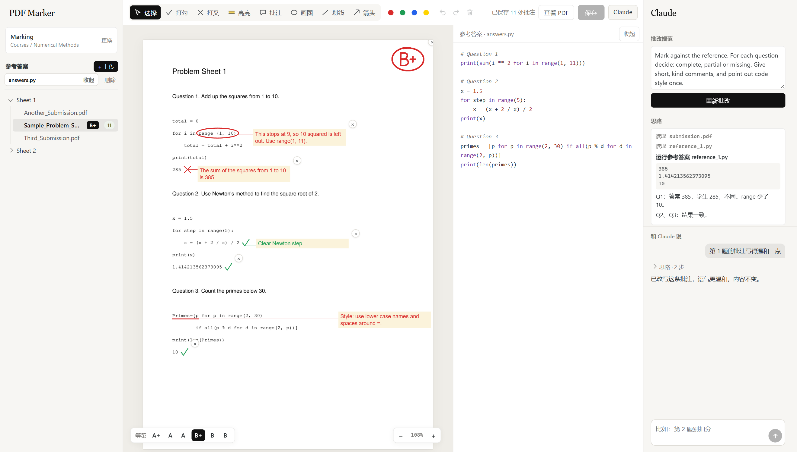

# PDF Marker



*The submission shown is made up. 图中的作业是虚构的。*

<details name="lang">
<summary><b>中文</b>（点击切换）</summary>

在本地网页里批改一整个文件夹的 PDF：打勾、打叉、高亮、批注、画圈、划线。标记以标准注释的形式存进原 PDF，学生用任何 PDF 阅读器都能看到，回到这里重新打开也还能修改。

所有内容都在你自己的电脑上运行。服务只监听 `127.0.0.1`，页面不从网上加载任何东西。只有一种情况文件会离开本机：你按下按钮，让 Claude 批改某份文件。

## 启动

需要 Python 3.10+ 和 tkinter（Windows 标准安装包和 conda 都自带），构建页面还需要 Node.js 20+。

```
pip install -r requirements.txt
cd web
npm install
npm run build
cd ..
python server.py
```

Windows 上双击 `start.cmd` 即可，第一次运行时它会自动构建页面。点 **选择工作区** 选一个文件夹：里面和子文件夹里的所有 PDF 都会按文件夹分组列出，并显示每份的标记数。这个文件夹下次会记住（存在 `~/.pdf-marker.json`）。也可以用 `python server.py --root <folder>` 打开指定的文件夹。

## 批改

| 按键 | 工具 | 用法 |
| --- | --- | --- |
| `V` | 选择 | 点击选中。拖动可移动，拖角可缩放，双击批注可编辑。 |
| `1` | 打勾 | 点击。 |
| `2` | 打叉 | 点击。随后打开一个相连的批注框，可以直接打字。 |
| `3` | 高亮 | 拖过要高亮的区域。 |
| `4` | 批注 | 点击后打字。 |
| `5` | 画圈 | 拖动。随后打开一个相连的批注框，可以直接打字。 |
| `6` | 划线 | 拖动。随后打开一个相连的批注框，可以直接打字。 |
| `7` | 箭头 | 朝要指的地方拖动。随后打开一个相连的批注框，可以直接打字。 |

- **等第。** 用左下角的等第栏给一份作业打一个等第，从 A+ 到 B-。它以马克笔笔迹画在第一页上，可以拖动，文件列表里也会显示。再按一次相同的等第就清除。
- **批注框。** `Enter` 确认，`Shift+Enter` 换行。点击别处也会确认，并继续使用当前工具。空的批注框会自动删除。
- **相连的批注。** 和 Word 一样，一条细线连着批注框和标记，移动任何一边都会跟着走。删除标记时，它的批注也一起删除。
- **移动批注。** 任何工具下都能拖动批注框。打字时拖它上方的深色横条。
- **缩放。** `Ctrl` 加滚轮或双指捏合，会以指针为中心缩放作业；`Ctrl` 加 `+`、`-`、`0` 可以逐级缩放或适应宽度。页面其他部分大小不变。
- **其他按键。** `Ctrl+S` 保存，`Ctrl+Z` 和 `Ctrl+Y` 撤销和重做，`Delete` 删除选中内容，`Esc` 回到选择工具。
- **切换文件** 时会先保存当前文件。
- **侧边栏。** 文件夹可以像资源管理器一样展开和收起。拖动左右侧边栏的内侧边缘可以调整宽度，双击边缘恢复默认。

## 用 Claude 批改

右侧面板默认打开，**Claude** 按钮可以隐藏它。使用前需要安装并登录 [Claude Code](https://claude.com/claude-code)。

1. **参考答案。** 位于左侧面板的工作区下方。用 **+ 上传** 上传正确答案，支持 PDF、Word（docx）、HTML 和常见代码文件。点击文件名，它会以只读方式显示在作业旁边（窄屏时在下方），切换作业时也保持打开。参考答案对整个工作区生效，上传一次，所有作业都能用。它们存在隐藏的 `.marker` 文件夹里。
2. **批改规则。** 写明好答案需要什么、批注怎么写，以及每个等第的含义。规则对整个工作区只存一份。
3. **批改。** 按下按钮。Claude 在你正在看的同一页上批改，用的是同样的七种工具，思路显示在面板里。每条批注都圈出或划出它针对的具体文字，并且是写给学生看的：提到参考答案或老师的批注会被拒绝，由 Claude 重写。
4. **留下想要的。** Claude 的标记一出现就是普通标记，保存后就写进 PDF。你可以像改自己的标记一样拖动、缩放、改写。如果你还没打等第，Claude 也会建议一个，用等第栏就能改。不想要某条标记，按它右上角的 ×：它不会再回来，需要时可以在面板里恢复。重新批改会替换 Claude 上一次的标记。
5. **和它对话。** 在面板里提修改要求，比如“第 2 题不要扣分”或“这条批注写得温和一点”。Claude 只改你说的部分，就在同一页上，每处改动都可以撤销。

按下按钮后，PDF 和参考答案会经 Claude Code 发送给 Anthropic，所以请先确认你所在的机构允许这样处理你批改的作业。发送的副本名为 `submission.pdf`，文件名不会发出去，也不包含你的标记。但写在 PDF 里面的姓名仍然会发送。

这个 agent 是被关起来的。它只读取你 Claude Code 设置里的 `effortLevel`，不加载任何 hooks、插件、skills 或 MCP 服务器。它能用的工具只有：限定在临时文件夹内的 `Read`、`marker_tools.py` 里的批改工具、修改自己标记的工具，以及 `run_answer`。系统还要求它忽略作业里写的任何指令。

如果参考答案是 `.py` 文件，Claude 会用 `run_answer` 在你的电脑上亲自运行它，文件每个版本只运行一次，然后把真实输出和作业里印出的输出逐行对比。两者不同时，它会读学生的代码，找到出问题的那一行。这个工具只接受参考文件的文件名，所以学生的代码永远不会被运行。只上传你信任的参考代码。

## 保存

保存时直接覆盖原 PDF。第一次保存时，未改动的原文件会留在旁边的 `.orig` 文件夹里。其他程序做的注释会保留，但不能在这里编辑。保存前请在其他阅读器里关掉这份 PDF，因为 Windows 会锁定打开的文件。

## 开发

`server.py` 负责读写 PDF。`web/` 里的页面是 Next.js 应用，构建成静态网站后由 `server.py` 提供，所以日常使用只需要一个进程。

要修改页面，双击 `dev.cmd`，打开 http://127.0.0.1:3000。改动会直接显示，不用刷新。这个页面用的是你真实的工作区，所以跑自动化测试时，请用 `python server.py --root <folder>` 指向一个临时工作区。

改完页面后，在 `web/` 里运行 `npm run build` 重新构建，否则 `start.cmd` 还会继续提供旧版本。

## 测试

```
python scripts/check.py
```

这会运行泄露检查、服务端测试、类型检查、构建和浏览器测试。浏览器测试需要 Chrome，用的是临时文件夹里生成的 PDF，绝不碰你的工作区。CI 在每次推送时运行同一个脚本。

要在提交时拦下新增的 PDF，每个克隆启用一次这个 hook：

```
git config core.hooksPath .githooks
```

## 参与贡献

只有项目所有者可以直接推送到 `main`。其他人需要提 pull request，由所有者批准后合并。详见 [CONTRIBUTING.md](CONTRIBUTING.md)。

## 许可证

MIT

</details>

<details name="lang" open>
<summary><b>English</b></summary>

Mark up a folder of PDFs in a local web page: ticks, crosses, highlights, comments, circles and lines. Marks are saved into the original PDF as standard annotations, so students see them in any PDF viewer, and they stay editable when you reopen the file here.

Everything runs on your own computer. The server listens on `127.0.0.1` only and the page loads nothing from the internet. Files leave the machine in one case: when you press the button that asks Claude to mark a file.

## Start

Needs Python 3.10+ with tkinter, which the standard Windows and conda installers include, and Node.js 20+ to build the page.

```
pip install -r requirements.txt
cd web
npm install
npm run build
cd ..
python server.py
```

On Windows, double-click `start.cmd`, which builds the page the first time. Click **选择工作区** and pick a folder: every PDF in it and in its subfolders is listed, grouped by folder, with a count of the marks in each. The folder is remembered for next time (in `~/.pdf-marker.json`). `python server.py --root <folder>` opens a specific one.

## Marking

| Key | Tool | Use |
| --- | --- | --- |
| `V` | Select | Click to select. Drag to move, drag a corner to resize, double-click a comment to edit it. |
| `1` | Tick | Click. |
| `2` | Cross | Click. A linked comment box opens for typing. |
| `3` | Highlight | Drag over the area. |
| `4` | Comment | Click, then type. |
| `5` | Circle | Drag. A linked comment box opens for typing. |
| `6` | Line | Drag. A linked comment box opens for typing. |
| `7` | Arrow | Drag towards what you mean. A linked comment box opens for typing. |

- **Grades.** Give a submission one grade, A+ to B-, with the bar at the bottom left. It is drawn in marker strokes on the first page, where it can be dragged, and shown beside the file in the list. Pressing the same grade again clears it.
- **Comment boxes.** `Enter` confirms and `Shift+Enter` starts a new line. Clicking elsewhere confirms too and carries on with the current tool. A box left empty is removed.
- **Linked comments.** A thin line joins the box to its mark, as in Word, and follows when either one moves. Deleting a mark deletes its comment.
- **Moving comments.** Drag a box under any tool. While typing, drag the dark bar on top of it.
- **Zoom.** `Ctrl` with the wheel, or a pinch, zooms the work around the pointer, and `Ctrl` with `+`, `-` or `0` steps it or fits it to the width. The rest of the page keeps its size.
- **Other keys.** `Ctrl+S` saves, `Ctrl+Z` and `Ctrl+Y` undo and redo, `Delete` removes the selection, `Esc` returns to Select.
- **Switching files** saves the current one first.
- **Side panels.** Folders open and close like a file explorer. Drag the inner edge of either side panel to resize it, and double-click the edge to reset it.

## Marking with Claude

The panel on the right opens by default, and the **Claude** button hides it. It needs [Claude Code](https://claude.com/claude-code) installed and signed in.

1. **Reference answers.** They sit under the workspace in the left panel. Upload the correct answers with **+ 上传**: PDF, Word (docx), HTML or common code files. Clicking a name opens it read-only beside the work, or below it on a narrow screen, and it stays open as you move between submissions. They belong to the whole workspace, so one upload serves every submission. They are stored in a hidden `.marker` folder.
2. **Marking rules.** Write what a good answer needs and how you want comments written. Say what each grade means too. The rules are kept once for the whole workspace.
3. **Mark.** Press the button. Claude marks the same page you are working on, with the same seven tools, and its reasoning appears in the panel. Each comment points at the exact words it is about, circled or underlined, and is written to the student: a comment that mentions the reference answer or the teacher is refused, and Claude rewrites it.
4. **Keep what you want.** Claude's marks are ordinary marks from the moment they appear, so saving puts them in the PDF. Drag, resize or reword them like your own. Claude also proposes a grade, unless you have already given one, and the grade bar changes it. To drop one, press the × on its top right corner: it stays gone, and the panel can restore it. Marking again replaces Claude's last marks.
5. **Talk to it.** Ask for changes in the panel, such as "don't take marks off question 2" or "make this comment gentler". Claude changes only what you ask, on the same page, and each change can be undone.

Pressing the button sends the PDF and its reference answers to Anthropic through Claude Code, so check that your institution allows this for the work you are marking. The copy sent is named `submission.pdf`, so the file name stays behind, and it doesn't include your marks. A name written inside the PDF is still sent.

The agent is shut in. It takes only `effortLevel` from your Claude Code settings, and loads no hooks, plugins, skills or MCP servers. Its only tools are `Read`, which is confined to a temporary folder, the marking tools in `marker_tools.py`, the tools that edit its marks, and `run_answer`. It is also told to ignore instructions written in the submission.

When a reference answer is a `.py` file, Claude runs it itself with `run_answer`, on your computer, once per version of the file, and compares what it really prints line by line with the output printed in the submission. When they differ, it reads the student's code to find the line responsible. The tool takes only a reference file's name, so student code is never run. Only upload reference code you trust.

## Saving

Saving overwrites the PDF in place. The first save keeps the untouched file in a `.orig` folder beside it. Annotations made by other programs are preserved, but they can't be edited here. Close the PDF in any other viewer before saving, because Windows locks open files.

## Development

`server.py` reads and writes the PDFs. The page in `web/` is a Next.js app, built to a static site that `server.py` serves, so everyday use needs only one process.

To work on the page, double-click `dev.cmd` and open http://127.0.0.1:3000. Edits appear there without reloading. That page uses your real workspace, so point automated tests at a throwaway one with `python server.py --root <folder>`.

After changing the page, rebuild it with `npm run build` in `web/`, or `start.cmd` keeps serving the previous build.

## Tests

```
python scripts/check.py
```

This runs the leak guard, server tests, type check, build and browser tests. The browser tests need Chrome, and they use generated PDFs in a temporary folder, never your workspace. CI runs the same script on every push.

To block a commit that adds a PDF, enable the hook once per clone:

```
git config core.hooksPath .githooks
```

## Contributing

Only the owner pushes to `main`. Everyone else opens a pull request, which merges after the owner approves it. See [CONTRIBUTING.md](CONTRIBUTING.md).

## License

MIT

</details>
