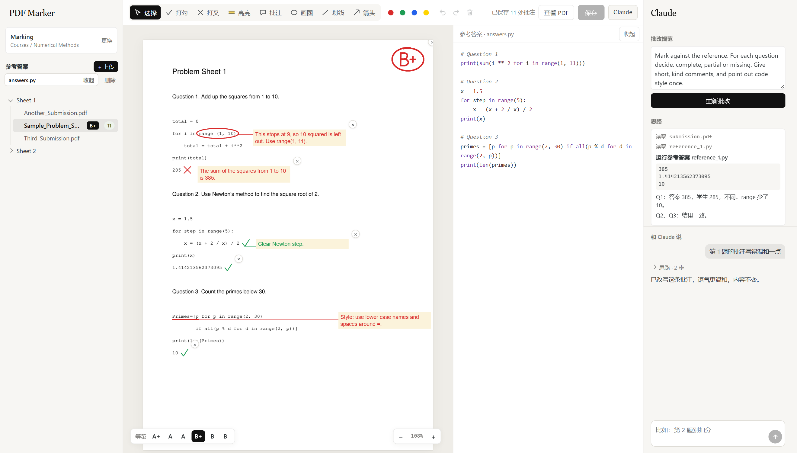

# PDF Marker

[English](README.md) | 中文

在本地网页里批改一整个文件夹的 PDF：打勾、打叉、高亮、批注、画圈、划线。标记以标准注释的形式存进原 PDF，学生用任何 PDF 阅读器都能看到，回到这里重新打开也还能修改。



*图中的作业是虚构的。*

所有内容都在你自己的电脑上运行。服务只监听 `127.0.0.1`，页面不从网上加载任何东西。只有一种情况文件会离开本机：你按下按钮，让 Claude 批改某份文件。

## 启动

需要 Python 3.10+ 和 tkinter（Windows 标准安装包和 conda 都自带），构建页面还需要 Node.js 20+。

```
pip install -r requirements.txt
cd web
npm install
npm run build
cd ..
python server.py
```

Windows 上双击 `start.cmd` 即可，第一次运行时它会自动构建页面。点 **选择工作区** 选一个文件夹：里面和子文件夹里的所有 PDF 都会按文件夹分组列出，并显示每份的标记数。这个文件夹下次会记住（存在 `~/.pdf-marker.json`）。也可以用 `python server.py --root <folder>` 打开指定的文件夹。

## 批改

| 按键 | 工具 | 用法 |
| --- | --- | --- |
| `V` | 选择 | 点击选中。拖动可移动，拖角可缩放，双击批注可编辑。 |
| `1` | 打勾 | 点击。 |
| `2` | 打叉 | 点击。随后打开一个相连的批注框，可以直接打字。 |
| `3` | 高亮 | 拖过要高亮的区域。 |
| `4` | 批注 | 点击后打字。 |
| `5` | 画圈 | 拖动。随后打开一个相连的批注框，可以直接打字。 |
| `6` | 划线 | 拖动。随后打开一个相连的批注框，可以直接打字。 |
| `7` | 箭头 | 朝要指的地方拖动。随后打开一个相连的批注框，可以直接打字。 |

- **等第。** 用左下角的等第栏给一份作业打一个等第，从 A+ 到 B-。它以马克笔笔迹画在第一页上，可以拖动，文件列表里也会显示。再按一次相同的等第就清除。
- **批注框。** `Enter` 确认，`Shift+Enter` 换行。点击别处也会确认，并继续使用当前工具。空的批注框会自动删除。
- **相连的批注。** 和 Word 一样，一条细线连着批注框和标记，移动任何一边都会跟着走。删除标记时，它的批注也一起删除。
- **移动批注。** 任何工具下都能拖动批注框。打字时拖它上方的深色横条。
- **缩放。** `Ctrl` 加滚轮或双指捏合，会以指针为中心缩放作业；`Ctrl` 加 `+`、`-`、`0` 可以逐级缩放或适应宽度。页面其他部分大小不变。
- **其他按键。** `Ctrl+S` 保存，`Ctrl+Z` 和 `Ctrl+Y` 撤销和重做，`Delete` 删除选中内容，`Esc` 回到选择工具。
- **切换文件** 时会先保存当前文件。
- **侧边栏。** 文件夹可以像资源管理器一样展开和收起。拖动左右侧边栏的内侧边缘可以调整宽度，双击边缘恢复默认。

## 用 Claude 批改

右侧面板默认打开，**Claude** 按钮可以隐藏它。使用前需要安装并登录 [Claude Code](https://claude.com/claude-code)。

1. **参考答案。** 位于左侧面板的工作区下方。用 **+ 上传** 上传正确答案，支持 PDF、Word（docx）、HTML 和常见代码文件。点击文件名，它会以只读方式显示在作业旁边（窄屏时在下方），切换作业时也保持打开。参考答案对整个工作区生效，上传一次，所有作业都能用。它们存在隐藏的 `.marker` 文件夹里。
2. **批改规则。** 写明好答案需要什么、批注怎么写，以及每个等第的含义。规则对整个工作区只存一份。
3. **批改。** 按下按钮。Claude 在你正在看的同一页上批改，用的是同样的七种工具，思路显示在面板里。每条批注都圈出或划出它针对的具体文字，并且是写给学生看的：提到参考答案或老师的批注会被拒绝，由 Claude 重写。
4. **留下想要的。** Claude 的标记一出现就是普通标记，保存后就写进 PDF。你可以像改自己的标记一样拖动、缩放、改写。如果你还没打等第，Claude 也会建议一个，用等第栏就能改。不想要某条标记，按它右上角的 ×：它不会再回来，需要时可以在面板里恢复。重新批改会替换 Claude 上一次的标记。
5. **和它对话。** 在面板里提修改要求，比如“第 2 题不要扣分”或“这条批注写得温和一点”。Claude 只改你说的部分，就在同一页上，每处改动都可以撤销。

按下按钮后，PDF 和参考答案会经 Claude Code 发送给 Anthropic，所以请先确认你所在的机构允许这样处理你批改的作业。发送的副本名为 `submission.pdf`，文件名不会发出去，也不包含你的标记。但写在 PDF 里面的姓名仍然会发送。

这个 agent 是被关起来的。它只读取你 Claude Code 设置里的 `effortLevel`，不加载任何 hooks、插件、skills 或 MCP 服务器。它能用的工具只有：限定在临时文件夹内的 `Read`、`marker_tools.py` 里的批改工具、修改自己标记的工具，以及 `run_answer`。系统还要求它忽略作业里写的任何指令。

如果参考答案是 `.py` 文件，Claude 会用 `run_answer` 在你的电脑上亲自运行它，文件每个版本只运行一次，然后把真实输出和作业里印出的输出逐行对比。两者不同时，它会读学生的代码，找到出问题的那一行。这个工具只接受参考文件的文件名，所以学生的代码永远不会被运行。只上传你信任的参考代码。

## 保存

保存时直接覆盖原 PDF。第一次保存时，未改动的原文件会留在旁边的 `.orig` 文件夹里。其他程序做的注释会保留，但不能在这里编辑。保存前请在其他阅读器里关掉这份 PDF，因为 Windows 会锁定打开的文件。

## 开发

`server.py` 负责读写 PDF。`web/` 里的页面是 Next.js 应用，构建成静态网站后由 `server.py` 提供，所以日常使用只需要一个进程。

要修改页面，双击 `dev.cmd`，打开 http://127.0.0.1:3000。改动会直接显示，不用刷新。这个页面用的是你真实的工作区，所以跑自动化测试时，请用 `python server.py --root <folder>` 指向一个临时工作区。

改完页面后，在 `web/` 里运行 `npm run build` 重新构建，否则 `start.cmd` 还会继续提供旧版本。

## 测试

```
python scripts/check.py
```

这会运行泄露检查、服务端测试、类型检查、构建和浏览器测试。浏览器测试需要 Chrome，用的是临时文件夹里生成的 PDF，绝不碰你的工作区。CI 在每次推送时运行同一个脚本。

要在提交时拦下新增的 PDF，每个克隆启用一次这个 hook：

```
git config core.hooksPath .githooks
```

## 参与贡献

只有项目所有者可以直接推送到 `main`。其他人需要提 pull request，由所有者批准后合并。详见 [CONTRIBUTING.md](CONTRIBUTING.md)。

## 许可证

MIT
